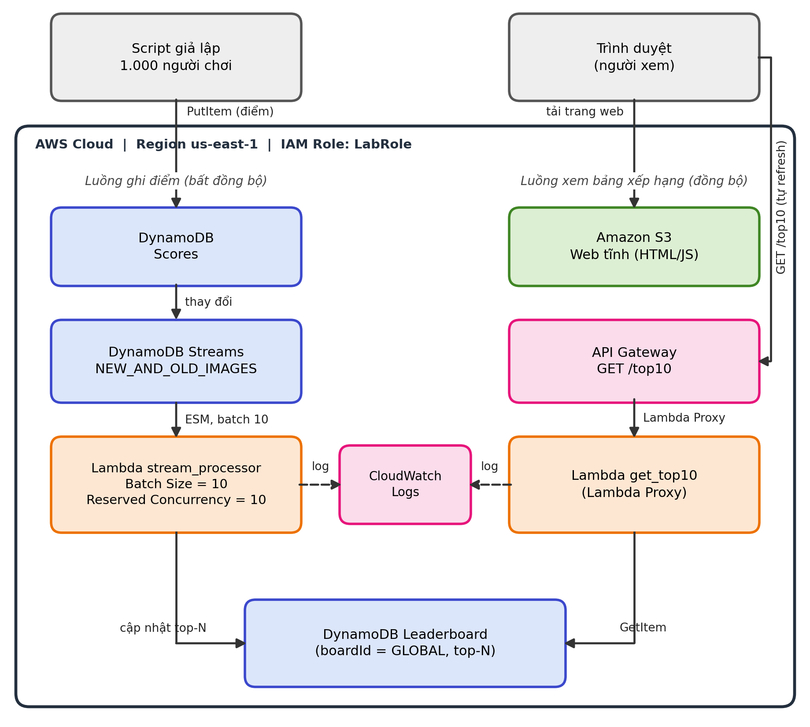

# leaderboard-project

Bảng xếp hạng game thời gian thực **serverless** trên AWS, dùng **DynamoDB Streams**.
Đề tài môn Điện toán đám mây (Cloud, Đợt 1, 2026-2027), nhóm Databases, GVHD: Huỳnh Xuân Phụng.

Thành viên: Cao Gia Huy (24110018), Nguyễn Nhân Hiếu Nghĩa (24110035).

Video demo: _[dán link video tại đây]_

## Kiến trúc



- **Ghi điểm:** client ghi vào bảng `Scores` (DynamoDB, bật Streams).
- **Xử lý:** Streams kích hoạt Lambda `stream_processor` (batch 10, reserved concurrency 10) tính top 10.
- **Lưu kết quả:** Lambda ghi item `GLOBAL` trong bảng `Leaderboard`, có kiểm tra `version` (ghi có điều kiện) để tránh ghi đè lẫn nhau.
- **Đọc:** trang web tĩnh trên **S3** gọi **API Gateway** `GET /top10`, API gọi Lambda `get_top10`. Trang tự làm mới mỗi 3 giây và dừng khi tab bị ẩn.
- **Giám sát:** CloudWatch dashboard `Leaderboard`, alarm `leaderboard-stream-Errors` và `leaderboard-stream-Throttles`, log retention 7 ngày.

## Cấu trúc repo

```
src/stream_processor/lambda_function.py   Lambda tính top 10 từ DynamoDB Streams
src/get_top10/lambda_function.py          Lambda trả top 10 cho API
web/index.html                            Trang web hiển thị Top 10
scripts/deploy.sh                         Dựng toàn bộ hệ thống bằng một lệnh
scripts/cleanup.sh                        Xóa toàn bộ tài nguyên (chạy lại được nhiều lần)
scripts/run_test.sh                       Kiểm thử CORS, throttling, S3 policy, mapping, alarm
scripts/simulate.py                       Giả lập 1.000 người chơi, tự đối chiếu kết quả
scripts/dashboard.json                    Định nghĩa CloudWatch dashboard
docs/                                     Báo cáo, worklog, sơ đồ kiến trúc, ảnh minh chứng
```

## Ràng buộc môi trường (AWS Learner Lab)

- Region **us-east-1**, dùng **LabRole**, không tạo IAM user/role.
- Mọi tài nguyên gắn tag `Project=Leaderboard` và `Owner=<tên>`.
- Lambda batch size và concurrency ≤ 10.
- Chạy script bằng **CloudShell** (đã có sẵn AWS CLI, Python 3, zip).

## Cách chạy

```bash
# 1. Lấy mã nguồn trong CloudShell
git clone https://github.com/LawrenceHuy/leaderboard-project-.git
cd leaderboard-project-

# 2. Deploy (tham số là giá trị tag Owner)
./scripts/deploy.sh CaoGiaHuy
# Cuối output phải thấy: Mapping state : Enabled | API /top10 : HTTP 200 | Web index : HTTP 200
# Địa chỉ API và web được in ở cuối và lưu trong /tmp/api_url.txt, /tmp/site_url.txt
```

Chạy giả lập (từ thư mục `scripts`, nên chạy một lần làm nóng sau khi deploy rồi xóa item `GLOBAL`):

```bash
cd scripts
python3 simulate.py --players 1000 --rounds 5 --threads 20
# Kết quả: MATCH nếu bảng Leaderboard khớp với kết quả tự tính tại máy

# Xóa bảng xếp hạng để chạy lại từ đầu
aws dynamodb delete-item --table-name Leaderboard --key '{"boardId":{"S":"GLOBAL"}}'
```

Mở địa chỉ `WEB:` ở cuối output deploy để xem Top 10 thay đổi khi giả lập đang chạy.

Kiểm thử bảo mật và giám sát:

```bash
./scripts/run_test.sh
```

## Dọn dẹp

```bash
./scripts/cleanup.sh CaoGiaHuy
./scripts/cleanup.sh CaoGiaHuy   # chạy lần 2 phải không lỗi
```

Cuối output là danh sách tài nguyên còn lại theo tag `Project=Leaderboard`, kỳ vọng **rỗng**.
Không bấm nút **Reset** của Learner Lab, vì nút này xóa hết tài nguyên của tài khoản.

## Kết quả kiểm thử (tuần 4, tài khoản Learner Lab mới)

| Hạng mục | Kết quả |
|---|---|
| Deploy từ đầu | Mapping Enabled, `/top10` = 200, web = 200 |
| 1.000 người × 5 vòng, 20 luồng | MATCH ở cả 4 lần chạy; thời gian ghi 16,6 – 145,4 giây |
| Cùng tải, 50 luồng | MATCH, 18,9 giây |
| CORS | Đúng origin có header, origin lạ không có header |
| Throttling | Có mã 429 khi gọi song song vượt giới hạn |
| S3 bucket policy | Chỉ `s3:GetObject` trên `bucket/*` |
| `cleanup.sh` chạy 2 lần | Lần 2 không lỗi, danh sách tài nguyên theo tag rỗng |

Số liệu hiệu năng đo từ CloudShell, mỗi cấu hình chạy ít lần, chỉ có giá trị tham khảo.
Thời gian ghi dao động mạnh giữa các lần chạy, nhóm chưa kết luận chắc chắn nguyên nhân.

Chi phí ước tính cho toàn bộ đợt kiểm thử dưới 0,03 USD (theo giả định trong báo cáo, chưa gồm đọc DynamoDB, S3, log CloudWatch).
Learner Lab hiển thị Used $0 of $50, con số này có thể cập nhật chậm.

## Hạn chế đã biết

- Bảng chỉ lưu top 10: nếu điểm của một người trong top bị **giảm** thì không có người thay thế (điểm trong game được giả định chỉ tăng).
- Mọi cập nhật đều dồn vào một item `GLOBAL`, nên khi nhiều Lambda chạy song song có xung đột về `version`. Code thử lại tối đa 6 lần, đã có 4 lần hết lượt thử gây lỗi Lambda (dữ liệu không mất vì Event Source Mapping tự thử lại).
- Website S3 chỉ có HTTP, không có HTTPS.
- Mọi Lambda dùng chung LabRole (giới hạn của Learner Lab).

## Tài liệu

Báo cáo các tuần, worklog và báo cáo cuối nằm trong thư mục `docs/`.
